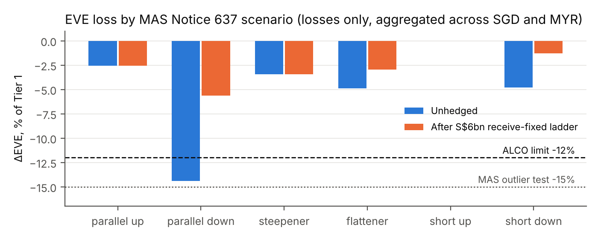

# Interest Rate Risk in the Banking Book: A Stylised Singapore Bank

IRRBB analysis of an illustrative Singapore bank with a Malaysian subsidiary: repricing gap, NII and EVE under the six MAS Notice 637 (BCBS) shocks, CASA behaviour, and a sized SORA OIS hedge for ALCO. Market data as of 3 November 2026; the bank is illustrative only, not any real institution.

## Summary

1. **EVE limit breached.** Worst-case ΔEVE is **−S$749m, 14.4% of Tier 1**, under the *parallel down* shock of MAS Notice 637. That breaches the 12% ALCO limit and sits just below MAS's 15% outlier test.
2. **Cause.** About S$22bn of core SGD deposits (CASA and savings) is modelled with an average life of about 4.0 years (4.5 years for transactional CASA), against assets that mostly reprice within 3 months. The bank loses value when SGD rates *fall*.
3. **NII has the same exposure, and it is asymmetric.** NII falls 30.6% under −200bp and rises 23.3% under +200bp. With CASA paying about 0.10%, deposit rates hit zero almost immediately in a rate cut.
4. **Recommendation:** S$6bn of receive-fixed SORA OIS laddered across 3Y, 5Y and 7Y. Worst-case ΔEVE falls to **5.6%** and NII under −200bp improves to −22.9%. Carry is small (about +S$9m over 12 months; the curve is nearly flat): this is a risk-reduction trade. The hedged book stays within the 12% EVE limit in 19 of the 20 CASA behaviour cases tested; it breaches at 14.0% in the shortest-life corner (2-year life, core −20pp).
5. **Main risks:** a further 50bp rise in SGD rates (roughly −S$137m mark-to-market on the swaps, PV01 about S$2.8m per bp), CASA behaviour assumptions, and a −200bp NII excess (22.9% vs 20%) left to pricing actions: the S$9bn that would close it breaches the EVE limit if CASA is less sticky.

| Metric | Unhedged | After S$6bn ladder | Limit |
|---|---|---|---|
| Worst ΔEVE, % Tier 1 (S$5.2bn) | 14.4 (parallel down) | 5.6 (parallel down) | 12.0 (ALCO), 15.0 (MAS outlier test) |
| ΔNII −200bp / +200bp, % of base NII (S$1,384m) | −30.6 / +23.3 | −22.9 / +15.6 | 20.0 |
| ΔNII, MAS parallel shocks (SGD ∓175, MYR ∓200bp), % | −26.1 / +21.1 | — | — |
| SGD PV01 (EVE change per +1bp), S$m | +4.05 | +1.56 | — |
| MYR PV01, S$m | −0.76 | −0.76 | — |

## Report

- **ALCO memo (2 pages):** [PDF](report/alco_memo.pdf) · [Markdown source](report/alco_memo.md)
- **All output tables:** [`outputs/results.md`](outputs/results.md) (CSV files and `headline.json` in [`outputs/`](outputs/))

## Key chart



## Method

**Balance sheet.** An SGD book of S$53.5bn and a Malaysian subsidiary of RM58bn, translated at SGD/MYR 3.18. The positions are fixed- and floating-rate loans, SORA- and SBR-linked mortgages, hire purchase, CASA and savings, fixed deposits, interbank, and an SGS or MGS/GII HQLA portfolio. Balances, client rates and repricing profiles are in `src/irrbb/balance_sheet.py`, all marked as assumptions.

**Repricing gap.** Each position's principal is placed in the bucket where it reprices: fixed-rate at maturity, floating-rate at the next reset, and NMDs by behavioural profile. The period gap in bucket $k$ is $G_k=\sum A_k-\sum L_k$, and the cumulative gap is $\sum_{j\le k}G_j$.

**NII sensitivity.** 12-month horizon, constant balance sheet, instantaneous parallel shock $\Delta r$. A slice of balance $N$ that reprices at time $t<1$ contributes

$$\Delta \mathrm{NII}=\sum_i s_i\,N_i\,\max\!\big(\beta_i\,\Delta r,\;-r_i\big)\,(1-t_i),$$

where $s_i=\pm1$ for assets and liabilities and $\beta_i$ is the pass-through. The term $-r_i$ floors administered client rates (deposits, client loans) at zero, a Board-approved floor that MAS Annex 10 ¶5.38(b) permits. Market-rate instruments (interbank, HQLA, bonds, swap legs) take only the MAS −100bp post-shock floor, so $-r_i$ becomes $-1\%-r_i$ (¶5.38(c)). NMD rates move with a one-month administered lag. MAS's regulatory ΔNII (¶5.37) uses the Annex 10C parallel shocks and is reported alongside the internal ±200bp measure.

**EVE sensitivity** follows the standardised framework of [MAS Notice 637](https://www.mas.gov.sg/regulation/notices/notice-637) (Annex 10B SA(IR) and Annex 10C, as amended 9 Oct 2025), which implements BCBS SRP31, for shocks, 19-bucket slotting, NMD caps, the −100bp post-shock floor and aggregation. BNM's IRRBB exposure draft is used as a cross-check. It does not apply the prescribed prepayment (CPR) and term-deposit redemption (TDRR) scalars or the automatic-option (AIRO) add-on. Notional repricing cash flows $CF_{c}(k)$ are netted in 19 time buckets and discounted at bucket midpoints $t_k$ on a risk-free curve:

$$\mathrm{EVE}_{i,c}=\sum_{k=1}^{19} CF_{c}(k)\,e^{-R_{i,c}(t_k)\,t_k},\qquad \Delta\mathrm{EVE}_{i,c}=\mathrm{EVE}_{i,c}-\mathrm{EVE}_{0,c}.$$

The shocked curve is $R_{i,c}(t)=R_{0,c}(t)+\Delta R_{i,c}(t)$, with the six scenarios defined as

$$
\begin{aligned}
\Delta R_{\text{parallel}}(t) &= \pm\bar R_{\text{parallel},c}\\
\Delta R_{\text{short}}(t) &= \pm\bar R_{\text{short},c}\,e^{-t/4}\\
\Delta R_{\text{long}}(t) &= \bar R_{\text{long},c}\,\big(1-e^{-t/4}\big)\\
\Delta R_{\text{steepener}}(t) &= -0.65\,|\Delta R_{\text{short}}(t)| + 0.9\,|\Delta R_{\text{long}}(t)|\\
\Delta R_{\text{flattener}}(t) &= +0.8\,|\Delta R_{\text{short}}(t)| - 0.6\,|\Delta R_{\text{long}}(t)|
\end{aligned}
$$

| Shock sizes, bp | Parallel | Short | Long | Source |
|---|---|---|---|---|
| SGD | 175 | 250 | 225 | MAS Notice 637 Annex 10C Table 10C-1 (effective 31 Dec 2025; BCBS d578 recalibration); cross-checked to BNM ED Table 8 |
| MYR | 200 | 175 | 225 | Not in Table 10C-1; Annex 10C ¶4 requires bank-derived shocks. BNM ED (30 Sep 2025) App. 5 Table 6 values used, back-solved and reproduced to ±1bp in `tests/test_shocks.py` |

After the shock, all rates are floored at −100bp (Annex 10C ¶8; non-binding at current levels). Currency results are aggregated with gains set to zero (MAS Annex 10B ¶6.3; the same rule is in BNM ED §21.2):

$$\text{EVE risk}=\max_{i\in\{1..6\}}\;\Big|\sum_{c:\,\Delta\mathrm{EVE}_{i,c}<0}\Delta\mathrm{EVE}_{i,c}\Big|,$$

and reported as a percentage of Tier 1. MAS treats a bank as an outlier above 15% of Tier 1 (Annex 10 ¶5.33).

**Behavioural assumptions.** Each NMD category is split into a core share $\phi$ and a non-core share $1-\phi$. The non-core share reprices overnight. The core share is spread evenly over $(0,2L]$, giving an average life of $L$, and is capped at $(\phi,L)\le$ (90%, 5y) for retail transactional, (70%, 4.5y) for retail non-transactional and (50%, 4y) for wholesale. The analysis flexes $\phi$, $L$ and $\beta$ and re-runs EVE and NII (see `outputs/results.md`).

**Hedge sizing.** An OIS swap is modelled as a fixed leg (quarterly coupons at the par rate $K=\frac{1-DF(T)}{\frac14\sum_j DF(t_j)}$) plus a floating leg that reprices at the next quarterly reset. The floating leg pays the 3M point of the curve and, as a market-rate instrument, is not floored at zero in NII. The notional $N^{\ast}$ is the smallest multiple of S$250m (S$750m for the ladder) such that

$$\max_i\ \text{EVE loss}_i(N^{\ast})\ \le\ 10\%\ \text{of Tier 1}\quad(\text{2pp headroom to the 12\% limit}).$$

Option C additionally requires the worst ΔNII under ±200bp to be at most 20%. The recommended S$6bn ladder is read from a notional scan (`outputs/hedge_notional_scan.csv`). The scan weighs the base-case limits against the adverse CASA case (core −20pp, 3-year life) and the 20-case behaviour grid.

### Market data and sources

| Item | Value used | Source | As of |
|---|---|---|---|
| Fed funds target | 3.75–4.00% | Federal Reserve FOMC statements: +25bp ([16 Sep](https://www.federalreserve.gov/newsevents/pressreleases/monetary20260916a.htm)), held 10–2 ([28 Oct](https://www.federalreserve.gov/newsevents/pressreleases/monetary20261028a.htm)) | 28 Oct 2026 |
| MAS policy band | rate of appreciation unchanged | [MAS Monetary Policy Statement](https://www.mas.gov.sg/news/monetary-policy-statements/2026/mas-monetary-policy-statement-14oct26) | 14 Oct 2026 |
| S$NEER slope | ~1.25% p.a. | Analyst estimates (MAS does not publish the slope) | 14 Oct 2026 |
| BNM OPR | 2.75% (unchanged since 9 Jul 2025) | [BNM MPC 2026](https://www.bnm.gov.my/monetary-stability/mpc-meetings/-/tag/mpc-2026); outlook: [The Star](https://www.thestar.com.my/business/business-news/2026/09/04/bank-negara-seen-holding-opr-at-275-in-november-hike-possible-in-2027) | 3 Sep 2026 (next MPC 5 Nov) |
| 12-week MAS bill (SGD 3M node; flat to O/N and 1M) | 1.84% | MAS auction cut-off, via [Growbeansprout](https://growbeansprout.com/t-bill-auction-22-oct-2026) | 13 Oct 2026 |
| 6M / 1Y T-bill | 1.90% / 1.90% | [MAS SGS benchmark closing yields](https://eservices.mas.gov.sg/statistics/fdanet/SgsBenchmarkIssuePrices.aspx) | 3 Nov 2026 |
| SGS 2Y / 5Y / 10Y | 1.85% / 2.00% / 2.21% | [MAS SGS benchmark closing yields](https://eservices.mas.gov.sg/statistics/fdanet/SgsBenchmarkIssuePrices.aspx) | 3 Nov 2026 |
| SGS 15Y / 20Y / 30Y | 2.25% / 2.22% / 2.25% | [MAS SGS benchmark closing yields](https://eservices.mas.gov.sg/statistics/fdanet/SgsBenchmarkIssuePrices.aspx) | 3 Nov 2026 |
| MGS 10Y | 3.90% (3.897% close) | [AsianBondsOnline (ADB)](https://asianbondsonline.adb.org/malaysia/) | 2 Nov 2026 |
| MYOR (MYR O/N node) | 2.75% | [BNM Malaysia Overnight Rate](https://www.bnm.gov.my/myor) | 2 Nov 2026 |
| 3M KLIBOR (MYR 3M node) | ~3.46% | KLIBOR fixing reported by [BusinessToday](https://www.businesstoday.com.my/2026/08/15/three-month-klibor-futures-expected-to-hold-steady-next-week/); no MYOR term rate exists | 15 Aug 2026 |
| 3M compounded SORA (context only) | ~1.2% | [MAS parliamentary reply](https://www.mas.gov.sg/news/parliamentary-replies/2026/oral-reply-to-parliamentary-question-on-the-impact-of-sustained-increases-in-us-treasury-yields) | 7 Oct 2026 |
| SGD/MYR | 3.18 | Twelve Data spot (3.1815) | 3 Nov 2026 |
| IRRBB rules (shocks, floor, NMD caps, aggregation) | see Method | [MAS Notice 637](https://www.mas.gov.sg/regulation/notices/notice-637) Annex 10/10B/10C (governing); cross-checks: [BCBS d578](https://www.bis.org/bcbs/publ/d578.htm), [BNM IRRBB exposure draft](https://www.bnm.gov.my/-/ed-irrbb-25) | amended 9 Oct 2025 |
| Intermediate curve nodes | see `src/irrbb/market.py` | SGD 3Y and 7Y: linear interpolation of SGS points; MYR 1M–7Y and 15Y+: author's shape between anchors | — |

### Assumptions

- **Capital and limits:** Tier 1 of S$5.2bn; EVE limit of 12% of Tier 1; hedge target of 10%; NII limit of 20% of base NII under ±200bp.
- **SGD discount curve:** the government curve (MAS bills / T-bills to 1Y, SGS beyond) stands in for a risk-free zero curve, ignoring the SGS–SORA OIS spread. The bank's own T-bill holdings are priced on it (1.87%).
- **Floors:** MAS −100bp post-shock floor on all market rates (EVE and NII); administered client rates floored at zero in NII.
- **Cash flows include contractual coupons, discounted at risk-free rates** (permitted by MAS Annex 10 ¶5.34(c)(i) and BNM ED §19.7(a)). The direction of the resulting bias in ΔEVE is not established.
- **Conventions:** market quotes are used directly as continuously compounded zero rates (no bootstrapping); fixed positions pay annual coupons; swap fixed legs pay quarterly; NII uses simple annual rates over a 12-month horizon.
- **No commercial-margin stripping, prepayment (CPR) model, early FD redemption or option (AIRO) add-on.** These are disclosed gaps, not modelled.
- **Rate pass-through:** MYR floating mortgages reprice within 1 month of an OPR move (SBR); FD pass-through is 0.85 on rollover.
- **Recommended notional:** S$6bn sits between the EVE-only minimum (S$3bn) and the size that meets both base-case limits (S$9bn). Only S$4.5bn passes all 20 behaviour cases, but it leaves a larger NII excess. The memo gives the trade-off.

## Reproduce

Tested with Python 3.13. The PDF step also needs `pandoc` and Node.js with Playwright (Chromium).

```bash
pip install -r requirements.txt
```

```bash
make all
```

`make all` runs the 47 tests, writes every table to `outputs/` and the figures to `report/figures/`, and rebuilds `report/alco_memo.pdf`. Without `make`, run `PYTHONPATH=src python -m pytest -q` and `PYTHONPATH=src python -m irrbb.run`. `tests/test_headline.py` fails if any number quoted in this README or the memo drifts from the code output.

```
src/irrbb/market.py         curves, shock sizes, capital and limits (sources and as-of dates)
src/irrbb/balance_sheet.py  stylised positions
src/irrbb/behavioural.py    NMD core/non-core slotting, caps, flex
src/irrbb/curves.py         zero curves, six shock scenarios, par swap rates
src/irrbb/engine.py         gap, NII, EVE, PV01, mark-to-market
src/irrbb/hedge.py          swap legs, sizing, before/after
src/irrbb/run.py            produces outputs/, figures, headline.json
tests/                      shock tables vs BNM ED, engine checks, headline regression
```

## Limitations

- **Single-date snapshot.** Market data is as of 2–3 November 2026, except the 12-week MAS bill (13 Oct) and the 3M KLIBOR anchor (15 Aug, the latest fixing found; later quotes are about 10bp higher).
- **Curves are proxies built from quoted anchors.** The SGD curve is a government curve, not a SORA OIS curve, and MAS asks for a risk-free zero rate (e.g. a secured swap curve). Quotes are yields, not bootstrapped zeros. The MYR curve uses MYOR overnight but KLIBOR, which carries a credit premium, at 3M because no MYOR term rate exists. Swap rates and carry are therefore indicative.
- **The S$NEER slope is an analyst estimate**; MAS does not publish it. It is context only and does not enter the calculations.
- **The balance sheet is stylised.** The headline percentages depend on its assumed composition and mainly show how the method behaves.
- **The behavioural assumptions dominate the result.** Worst-case EVE ranges from 4.8% to 18.2% of Tier 1 across plausible CASA settings, and the core shares are not estimated from 10 years of deposit history, as MAS (Annex 10B) and the BNM draft expect.
- **Slotting to bucket midpoints moves cash flows** (a 5Y bullet is discounted at 4.5Y). This understates the 5Y swap's ΔEVE by about 10% compared with exact discounting (`engine.pv_exact`).
- **The MAS −100bp post-shock floor does not bind** at current rate levels; even a 0% floor would leave the worst case at 14.4% of Tier 1 (`outputs/headline.json`).
- **NII uses a static balance sheet and an instantaneous parallel shock.** There are no ramped or forward-curve scenarios, no margin compression from competition, and the hedge's floating leg is held at today's 3M rate.
- **MYR shocks are a proxy.** MAS requires a bank to derive shocks for currencies outside Table 10C-1 (Annex 10C ¶4). The BNM exposure-draft calibration is used instead of a bank-derived series, and the BNM rules themselves may change.
- **No credit-spread risk in the banking book (CSRBB), basis risk model or optionality valuation.**

## Author

Huwa Jia Wei, NUS Economics & Statistics. Released under the [MIT License](LICENSE).
