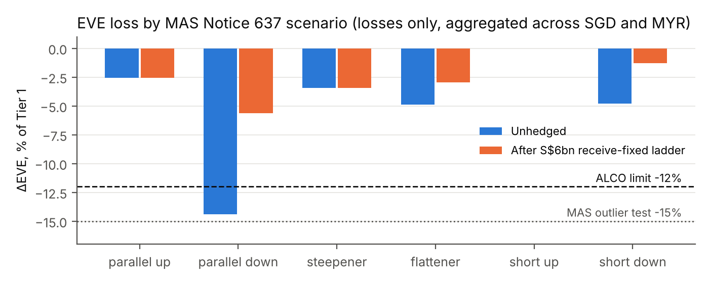

**To:** Asset & Liability Committee\
**From:** Huwa Jia Wei, Treasury – ALM\
**Date:** 3 November 2026\
**Subject:** IRRBB position and a proposed SGD structural hedge (decision required)

*Illustrative bank (S$71.7bn total assets: SGD book plus a Malaysian subsidiary). Not any real institution. All balances are assumptions; market data is as of 3 Nov 2026 (sources in the README); † marks indicative figures. Measured under MAS Notice 637 (Annex 10B/10C, as amended 9 Oct 2025); BNM's IRRBB exposure draft used as a cross-check.*

### 1. Recommendation

Approve **S$6bn of receive-fixed SORA OIS**, laddered equally across 3Y, 5Y and 7Y (S$2bn each), executed in three tranches by end-January 2027. This brings the worst-case EVE loss from **14.4% to 5.6% of Tier 1**, against the 12% ALCO limit and the 15% MAS outlier test. It cuts the NII loss under −200bp from 30.6% to 22.9% of base NII. Carry is small, about **+S$9m** over 12 months against today's 3M rate (about S$5m if fixings follow the forward curve): this is a risk-reduction trade, not a carry trade. The NII limit (20%) would remain exceeded under −200bp. Section 5 sets out the trade-off and a remediation plan.

### 2. Current position

| | Value | Limit / reference |
|---|---|---|
| Worst ΔEVE (parallel down) | −S$749m, **14.4% of Tier 1** | 12% ALCO limit (**breached**), 15% outlier test |
| ΔNII, 12M, −200bp / +200bp | −30.6% / +23.3% of S$1,384m | 20% limit (**breached on −200bp**) |
| ΔNII, MAS parallel shocks (SGD ∓175, MYR ∓200bp) | −26.1% / +21.1% | MAS Annex 10 ¶5.37 basis |
| PV01 (EVE change per +1bp) | SGD +S$4.05m, MYR −S$0.76m | — |

- **SGD book: liability-long.** S$31bn of CASA and savings, of which ~S$22bn is modelled as core with a 4.5-year life for transactional CASA. This core funding is longer than the assets it funds: floating SORA mortgages and corporate loans reprice within 3 months, and the SGS portfolio has an average maturity of about 4.8 years. When rates fall, the value of these low-rate deposits rises, and EVE falls.
- **MYR book: asset-long.** Fixed-rate hire purchase and a MYR10bn MGS/GII portfolio. It loses 3.4% of Tier 1 under the steepener and 2.6% under parallel up. MAS aggregates losses only (Annex 10B ¶6.3; BNM's draft is the same), so gains in one currency do not offset the other.
- **NII is asset-sensitive and asymmetric.** Retail CASA pays 0.10%, so it can absorb only 10bp of any rate cut before it hits zero. A −200bp shock therefore costs more NII than +200bp adds.
- **The shock recalibration matters.** The recalibrated SGD shocks (175/250/225bp, MAS Annex 10C, effective 31 Dec 2025) add 2.2pp to worst-case EVE versus the 2016 calibration (12.2% → 14.4%).

### 3. Risk under the regulatory scenarios (ΔEVE, % Tier 1, losses only)

| Scenario | Parallel up | Parallel down | Steepener | Flattener | Short up | Short down |
|---|---|---|---|---|---|---|
| Unhedged | −2.6 | **−14.4** | −3.4 | −4.9 | 0.0 | −4.8 |
| After S$6bn ladder | −2.6 | −5.6 | −3.4 | −3.0 | 0.0 | −1.3 |

**Behavioural assumptions drive this result.** Worst-case EVE ranges from **4.8% to 18.2%** of Tier 1 across plausible combinations of core share (−20 to +5pp) and transactional-CASA life (2–5 years). Deposit beta matters only in rising rates: moving SGD retail CASA beta from 0.15 to 0.50 reduces the +200bp NII gain from S$322m to S$213m. Under −200bp the zero floor on deposit rates binds and beta stops mattering.

### 4. Market context and why the hedge is a receive-fixed position

- **Fed:** hiked 25bp to 3.75–4.00% on 16 Sep, then held on 28 Oct with two dissents in favour of a further hike. Markets price a December hike.
- **MAS:** kept the S$NEER band's rate of appreciation unchanged on 14 Oct (slope about 1.25%†). SGD rates largely follow USD rates. The SGD curve is built from MAS bills / T-bills to 1Y (1.84–1.90%) and SGS beyond (2Y 1.85%, 5Y 2.00%, 10Y 2.21% on 3 Nov).
- **BNM:** OPR and MYOR at 2.75%, with the MPC deciding on 5 Nov. A hold is expected; houses see a 2027 hike to 3.00%. MGS 10Y closed at 3.90% on 2 Nov.
- **Carry:** the curve is flat to 2Y and rises only about 35bp to 10Y. Receiving 3Y / 5Y / 7Y at 1.90% / 2.00% / 2.08%† against a 1.84% floating rate earns little.
- **Timing:** the hedge reduces an exposure to *falling* SGD rates; it is not a rate view. The house view and market pricing lean towards higher rates, so execution is split into three tranches to average the entry level.
- **Under the house view** (SGD +25bp, MYR +25bp), unhedged NII rises by S$40m.

### 5. Alternatives considered

| Option | Notional | Worst ΔEVE | ΔNII −200 / +200 | Carry | SGD PV01 |
|---|---|---|---|---|---|
| A: 5Y only, EVE target | S$3bn | 10.0% | −26.7% / +19.4% | +S$5m | +2.8m |
| **B: 3/5/7Y ladder (recommended)** | **S$6bn** | **5.6%** | **−22.9% / +15.6%** | **+S$9m** | **+1.6m** |
| C: meets both limits | S$9bn | 3.4% (steepener) | −19.1% / +11.8% | +S$14m | +0.3m |

- **The trade-off is between the NII limit and robustness to CASA behaviour.** Only a ladder of S$9bn or more meets the 20% NII limit. But from S$7.5bn upwards the hedged book breaches the 12% EVE limit if deposits prove less sticky (core −20pp, 3-year life). Only S$4.5bn passes all 20 behaviour cases tested, and it leaves a 4.8pp NII excess.
- **Option A** only just meets the 10% EVE target, leaving 2.0pp of headroom to the limit, and depends on the 4.5-year CASA-life assumption.
- **Option C** meets both base-case limits. If CASA is less sticky it breaches the EVE limit (14.2% at core −20pp / 3-year life; 5 of 20 cases above 12%). It also gives up more of the NII upside and needs 50% more collateral than B.
- **Option B** keeps the adverse case inside the limit (10.2%). It leaves a −200bp NII excess of 2.9pp (22.9% vs 20%) to non-derivative actions:
  - introduce SORA floors on new floating-rate mortgage pricing;
  - tilt new origination towards 2–3Y fixed-rate packages;
  - review FD tenor pricing.
- Proposed governance: ALCO notes the NII excess as temporary and reviews it at the Q1 2027 meeting, after MAS's January policy statement.

### 6. Risks of the recommendation

1. **Rates keep rising.** The hedge has a PV01 of about S$2.8m per bp on actual cash-flow dates (S$2.5m on the regulatory bucket basis), so a further +50bp in SGD rates is roughly a −S$137m mark-to-market on the swaps. Economically the CASA franchise gains more, but in the accounts only the swap's loss is visible. **Mitigants:** execute in tranches (now, after the 9 Dec FOMC, after MAS's January MPS); designate as cash flow hedges of SORA-linked loan interest so mark-to-market goes to the CFH reserve, which Basel III excludes from CET1. The FVOCI bond portfolio, by contrast, does hit CET1.
2. **CASA proves less sticky than modelled** (for example, migration to FDs if rates rise). With core −20pp and a 3-year CASA life, the hedged book's worst case becomes **10.2% in parallel up**: inside the 12% limit, where Option C would reach 14.2%. Across the full grid tested (core −20 to +5pp, life 2–5 years) the hedged book stays within 12% in 19 of 20 cases. The exception is a 2-year life with core −20pp, where it **breaches the limit at 14.0%**. Behavioural assumptions should be re-estimated each quarter.
3. **Basis and pricing risk.** Swaps reset on compounded SORA, while the discount curve is the government curve and loan and deposit rates are set administratively. Repricing lags and the SORA–bill basis will create NII noise that the hedge does not remove.
4. **Model risk.** The standardised framework slots cash flows to bucket midpoints, which understates the hedge's true value sensitivity by about 10% for a 5Y swap, so the swaps' mark-to-market moves more than the regulatory measure shows. MAS's −100bp post-shock floor is applied and does not bind; even a 0% floor would leave the worst case at 14.4%. The analysis has no prepayment or term-deposit redemption model and no option risk add-on.
5. **Counterparty and liquidity risk.** Trades will be cleared or under CSA. Variation margin on a 50bp adverse move (about S$137m) is covered several times over by HQLA.

{width=80%}

**Decision requested:** approve Option B (S$6bn) with a tranche schedule, delegated to the Treasurer, and note the temporary NII excess and the remediation plan.

† = indicative. MAS does not publish the S$NEER slope (1.25% is an analyst estimate). Swap rates are implied from the government curve (MAS bills / T-bills to 1Y, SGS beyond), not dealer quotes; the 3M point is the 13 Oct 12-week MAS bill cut-off. Sources and method: see README.
